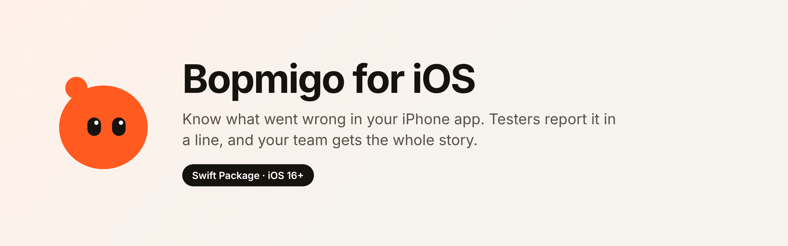
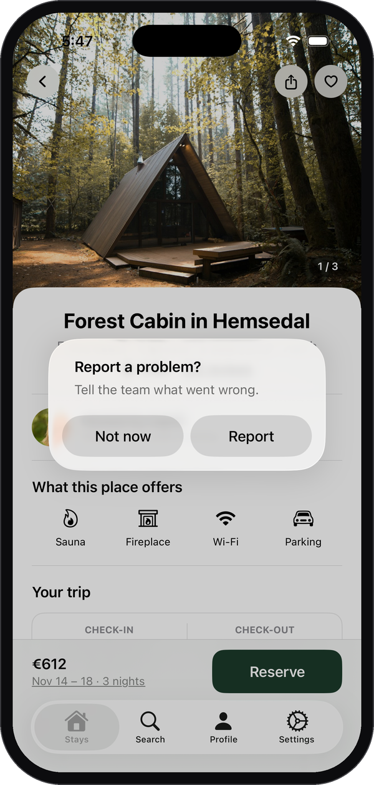
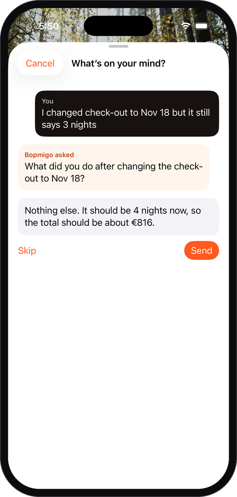
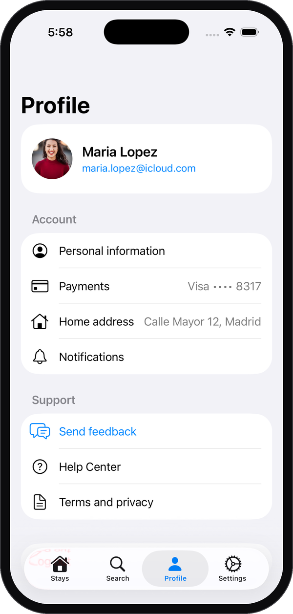

<p align="center"></p>

<p align="center">
  <a href="https://swiftpackageindex.com"></a>
  
  
  <a href="LICENSE"></a>
</p>

Know what went wrong in your iPhone app. Testers report it in a line or two, and your team gets the whole story, with a short follow-up if something important is missing.

Reports arrive in your [Bopmigo](https://bopmigo.com) inbox, or in your email if you prefer.

## How it works

<table>
<tr>
<td width="33%" valign="top"><br><b>1. Report in the moment</b><br>Testers take a screenshot, or tap your own button, and write a line.</td>
<td width="33%" valign="top"><br><b>2. Nothing important missing</b><br>If something is unclear, Bopmigo asks a short follow-up. They can always skip it.</td>
<td width="33%" valign="top"><br><b>3. Or from your own button</b><br>A Send feedback row anywhere in your app opens the same sheet. Your team gets a summary, their words, the screen, the device and a screenshot with private details covered.</td>
</tr>
</table>

<sub>Screens from the sample app in <code>Example/</code>, running in the iOS Simulator. Photos from Unsplash.</sub>

## Requirements

iOS 16 or later. SwiftUI and UIKit.

## Install

1. Create a free account at [bopmigo.com](https://bopmigo.com) and connect an **iPhone app**. Copy your app ID.
2. In Xcode, choose **File › Add Package Dependencies…**, paste `https://github.com/bopmigo/bopmigo-swift` and add **Bopmigo** to your app.
3. Configure it once when your app starts:

```swift
import Bopmigo

@main
struct MyApp: App {
    init() {
        Bopmigo.configure(siteID: "YOUR-APP-ID")
    }
    var body: some Scene { WindowGroup { ContentView() } }
}
```

4. Run the app and take a screenshot (in the Simulator: **Device › Trigger Screenshot**). Tap **Report** and send a test.

## Who sees "Report a problem?"

```swift
Bopmigo.configure(siteID: "YOUR-APP-ID", screenshotPrompt: .testersOnly) // default
Bopmigo.configure(siteID: "YOUR-APP-ID", screenshotPrompt: .always)
Bopmigo.configure(siteID: "YOUR-APP-ID", screenshotPrompt: .never)
```

- `.testersOnly` (default): only in builds from Xcode and TestFlight. People who install from the App Store are never asked.
- `.always`: everyone who takes a screenshot is asked.
- `.never`: no offer after screenshots; open feedback from your own button.

## Open feedback from your own button

```swift
Button("Send feedback") { Bopmigo.show() }
```

## Options

```swift
CheckoutView().bopmigoScreen("Checkout")   // reports say which screen
Text(user.email).bopmigoPrivate()          // covered in screenshots (UIKit: view.bopmigoPrivate = true)
Bopmigo.setHideAllText(true)               // cover every word in screenshots
Bopmigo.setUser(id: user.id, email: user.email, name: user.name)  // only if you want it in reports
Bopmigo.setContext("plan", "pro")          // your own details
```

Password fields are always covered.

## What is sent

The note, the answer to the one follow-up question if given, a screenshot with private areas covered, the app version and build, iOS version, device model, language, time zone and the screen name you set. Nothing about the person unless you call `setUser`. If sending fails, the report is kept on the device and sent when the connection is back.

## Example

`Example/BopmigoSampleApp.swift` is a small booking app with a few planted problems to try it with.

## Docs

[bopmigo.com/docs/add-in-app-feedback-to-ios-app](https://bopmigo.com/docs/add-in-app-feedback-to-ios-app)

## License

MIT
